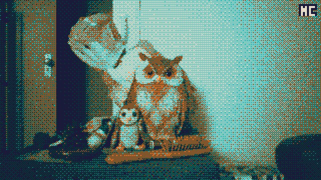
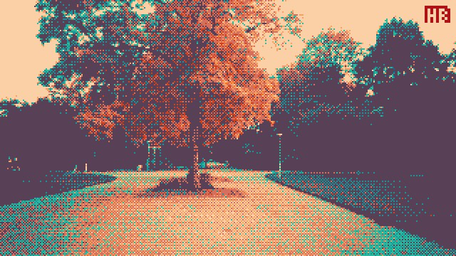
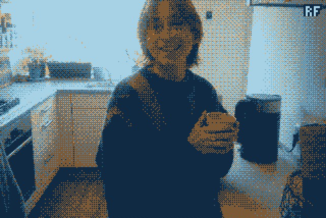
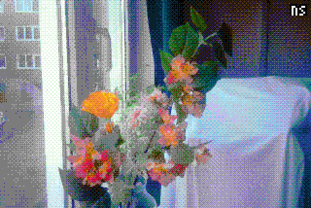
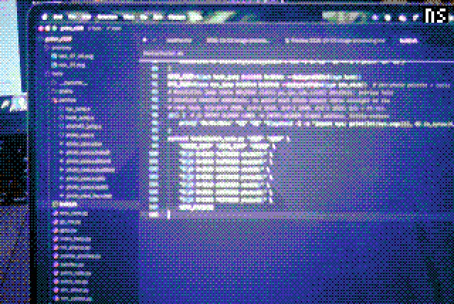
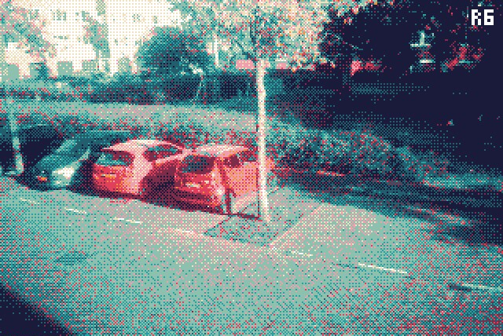

# Tinkering with the Godox C100 firmware

I'm not that much of a hardware tinkerer, but AI is getting so good, and it had no problem helping me figure out how to disassemble and patch the firmware of this toy camera I got :P

The firmware and flashing instructions are published by the manufacturer: https://www.godox.com/product-e/C100.html

The camera runs on a GeneralPlus (GP22B) chip, an ARM processor running FreeRTOS that is apparently often used for cheap dashcams and kids’ cameras and other gadgets like these.

## Sounds

I updated the startup and shutter sounds to the Coin and Kick sound from Super Mario, which I got from here: https://themushroomkingdom.net/media/smb/wav. They needed to be reduced in bitrate, and compressed and shortened a bit though.

## Retro colorized pixelated dithering

And then, I made the pictures and videos pixelated, dithered, and colored -- like the Pixless Camera project (mine still hasn't arrived haha, but now I have my own!)

<table>
    <tr>
        <td></td>
        <td></td>
        <td></td>
    </tr>
    <tr>
        <td></td>
        <td></td>
        <td></td>
    </tr>
    <tr>
        <td></td>
        <td></td>
        <td></td>
    </tr>
</table>
