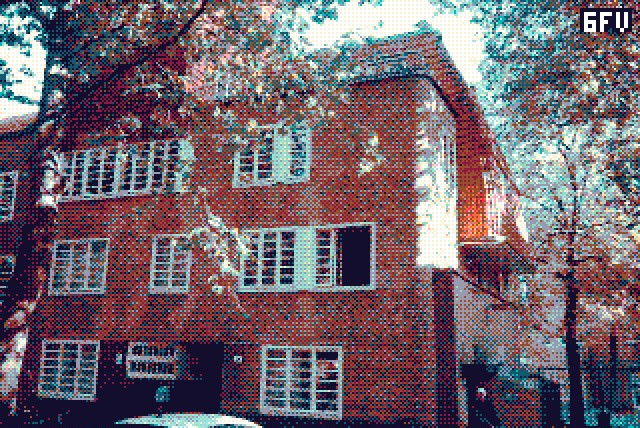
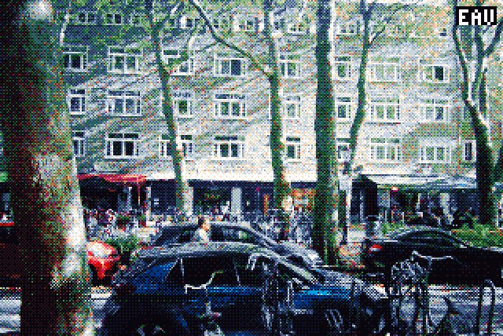
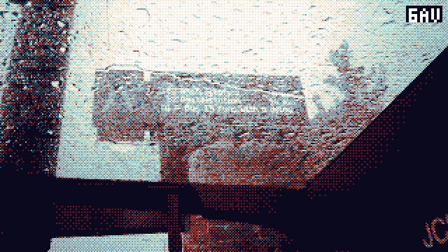
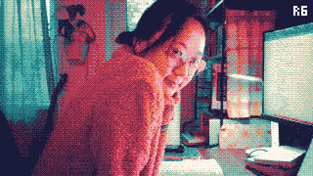
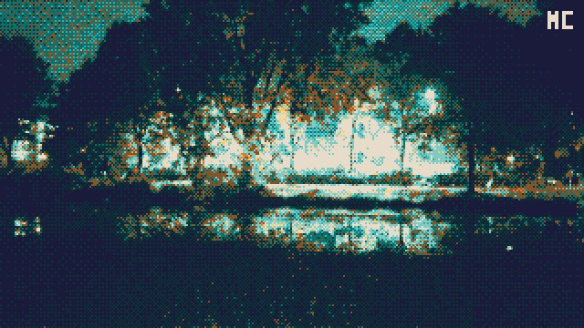
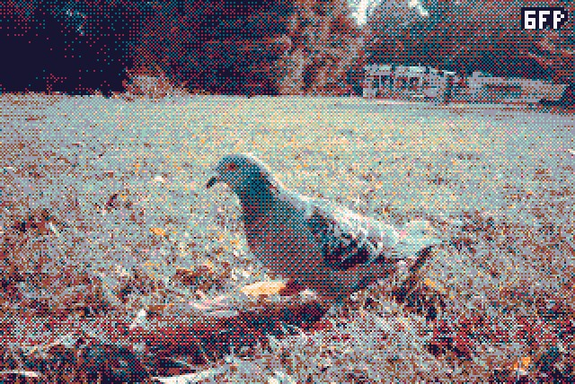
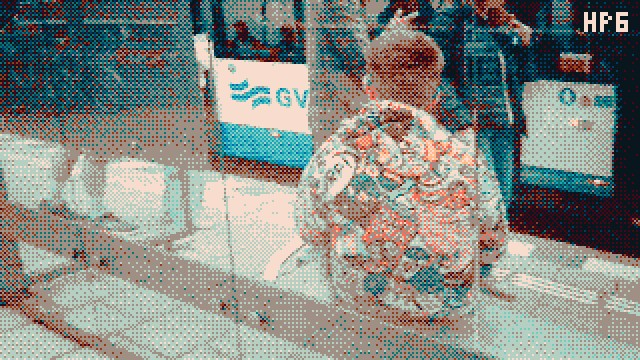
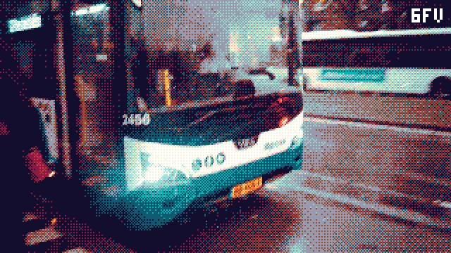
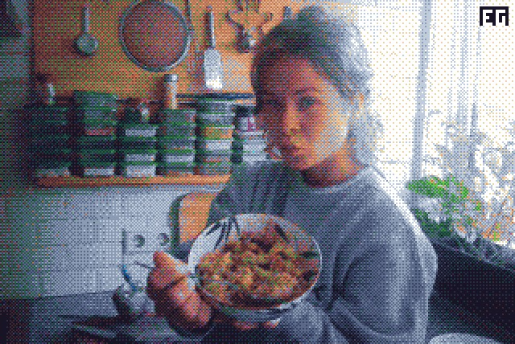

# Patching the C100's firmware to take retro dithered pics

I'm not that much of a hardware tinkerer, but AI is getting so good, that it had no problem disassembling and patching the firmware of this toy camera, so that I could get it to take cool retro pictures. Pixelated, dithered, and color graded:

<table>
    <tr>
        <td></td>
        <td></td>
        <td></td>
        <td></td>
    </tr>
    <tr>
        <td></td>
        <td></td>
        <td></td>
        <td></td>
    </tr>
    <tr>
        <td></td>
        <td></td>
        <td></td>
        <td></td>
    </tr>
    <tr>
        <td></td>
        <td></td>
        <td></td>
        <td></td>
    </tr>
</table>

## How to get this on your Godox C100

### Step 1

Copy the file [`build_backups/v034_sharpen_brackets.bin`](./build_backups/v034_sharpen_brackets.bin) (or any other older or newer version; or make your own on the site: palettes, the Game Boy Camera mode and its colours, the corner tag, sounds and their volume) to the root of the SD card of your Godox, and rename it to `GP_CARDVR_UPGRADE.BIN`.

_Either you connect via USB-C while the Godox is on, copy and rename the file, eject, and turn of the Godox; or you insert the SD card using a connector to your computer and then place it back in the turned-off Godox._

### Step 2

Turn your Godox on, and wait about 10 seconds while the light flashes. After this it will automatically restart, now running the new firmware.

_If the Godox doesn't flash its lights and restart after 10 seconds, chances are you copied the file to a subdirectory or named it incorrectly._

### Step 3

Have fun!

## What this fork adds

On top of the original palettes (EP6, 6FP, BW) and rnd, the center button now also cycles through:

- **Game Boy Camera mode (`Gb`):** 128×112, four shades, the Game Boy Camera's own edge sharpening, exposure and 4×4 dither thresholds (the maths of gb-photo by Toxa and the Pan Docs reference, through [PixelBoy](https://github.com/DonaldLSayers/PixelBoy-ESP32-P4X-EYE)), saved at 512×448 (8:7). Four colours of your choice, with Lospec 4-colour presets. The arrow keys are locked to the 8:7 size while it's on. Focusing can be awkward with it: the fixed-focus lens suits it less than the sensor the real camera had.
- **Normal mode (`nor`):** no effect, photos and video at the factory's full sizes (1920×1080, 1616×1080, 1440×1080, 1024×1024), the arrow keys work as usual.

The cycle is EP6, 6FP, BW, rnd, Gb, nor, then back. Every change into or out of the Gb or nor mode restarts the camera (about a second), like an aspect change does.

Also: the corner tag is optional (off by default), the stock shutter, power-on and click sounds are back at 10 % volume, and the flasher site ([`site/`](./site)) can set all of it before you download: palettes (with 29 Lospec presets and their makers credited), the Game Boy mode's colours, tone curve, contrast, brightness and edge sharpening, the contrast and brightness of the other palettes, the tag, the sounds and their volume. The site's firmware is byte-identical to what `tools/build.sh` makes (`sh tools/editor_check.sh`). Run the site locally with `python3 tools/serve.py 8765`.

**Tested:** in an ARM emulator (`tools/emu_gb.py`, `tools/emu_seg.py`, `tools/emu_cave.py`) and with the parity check. Earlier builds of the Game Boy mode, sizes and sounds have been run on a camera; the newest additions (stock-size normal mode, its aspect brackets, edge sharpening, contrast and brightness) have only been through the emulator.

## Technical details

The firmware and flashing instructions are published by the manufacturer: https://www.godox.com/product-e/C100.html. The camera runs on a GeneralPlus (GP22B) chip, an ARM processor running FreeRTOS that is apparently often used for cheap dashcams and kids’ cameras and other gadgets like these. I let Claude Code do all of the heavy lifting, as I'm not so experienced in this stuff. [Full documentation can be found here.](./docs/c100-firmware.md)

<!--
## Sounds

I first updated the startup and shutter sounds to the Coin and Kick sound from Super Mario, which I got from here: https://themushroomkingdom.net/media/smb/wav. They needed to be reduced in bitrate, and compressed and shortened a bit though. Later though, I removed them altogether, and also stopped the speaker from turning on, because even playing empty wav files, it would cause this hissing sound.
-->
