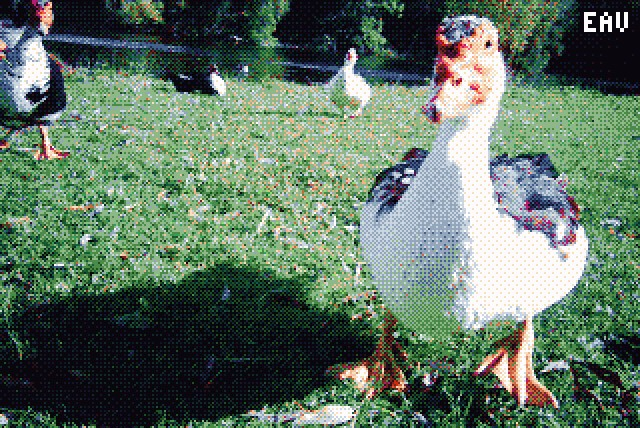
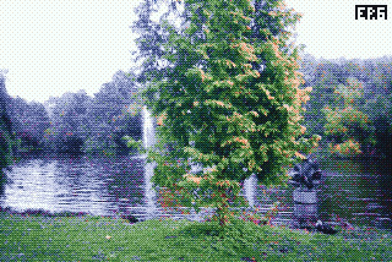
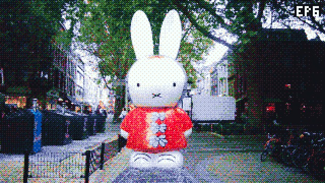
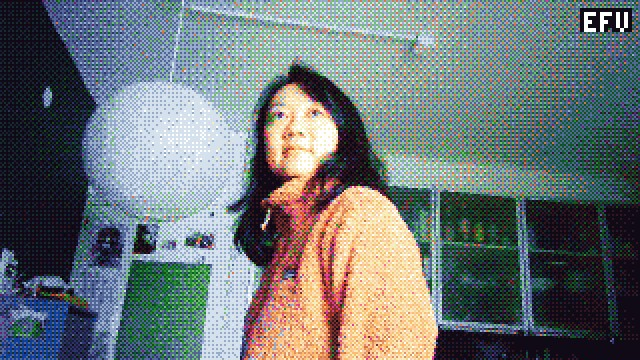
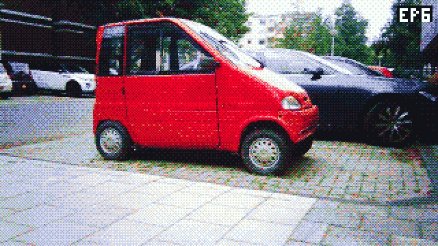
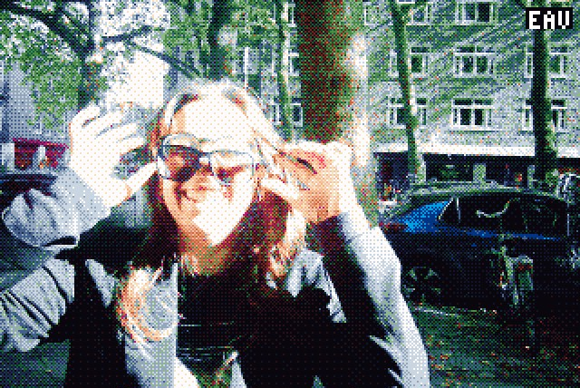
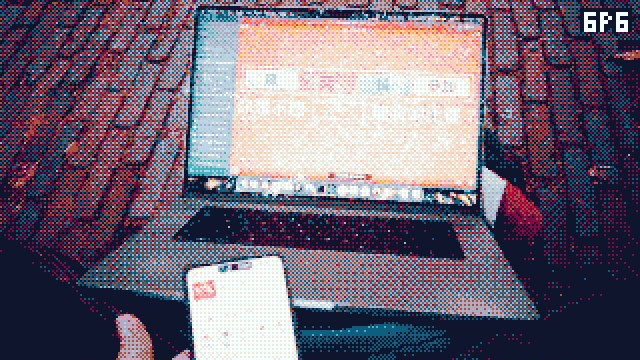

# Tinkering with the Godox C100 firmware

I'm not that much of a hardware tinkerer, but AI is getting so good, that it had no problem disassembling and patching the firmware of this toy camera, so that I could get it to take cool retro pictures. Pixelated, dithered, and color graded:

<table>
    <tr>
        <td></td>
        <td></td>
        <td></td>
        <td></td>
    </tr>
    <tr>
        <td></td>
        <td></td>
        <td></td>
        <td></td>
    </tr>
    <tr>
        <td></td>
        <td></td>
        <td></td>
        <td></td>
    </tr>
    <tr>
        <td></td>
        <td></td>
        <td></td>
        <td></td>
    </tr>
    <tr>
        <td></td>
        <td></td>
        <td></td>
        <td></td>
    </tr>
</table>

## How to get this on your Godox C100

### Step 1

Copy the file [`build_backups/v020_video_274k.bin`](./build_backups/v020_video_274k.bin) (or any other older or newer version) to the root of the SD card of your Godox, and rename it to `GP_CARDVR_UPGRADE.BIN`.

_Either you connect via USB-C while the Godox is on, copy and rename the file, eject, and turn of the Godox; or you insert the SD card using a connector to your computer and then place it back in the turned-off Godox._

### Step 2

Turn your Godox on, and wait about 10 seconds while the light flashes. After this it will automatically restart, now running the new firmware.

_If the Godox doesn't flash its lights and restart after 10 seconds, chances are you copied the file to a subdirectory or named it incorrectly._

### Step 3

Have fun!

## Technical details

The firmware and flashing instructions are published by the manufacturer: https://www.godox.com/product-e/C100.html. The camera runs on a GeneralPlus (GP22B) chip, an ARM processor running FreeRTOS that is apparently often used for cheap dashcams and kids’ cameras and other gadgets like these. I let Claude Code do all of the heavy lifting, as I'm not so experienced in this stuff. [Full documentation can be found here.](./docs/c100-firmware.md)

<!--
## Sounds

I first updated the startup and shutter sounds to the Coin and Kick sound from Super Mario, which I got from here: https://themushroomkingdom.net/media/smb/wav. They needed to be reduced in bitrate, and compressed and shortened a bit though. Later though, I removed them altogether, and also stopped the speaker from turning on, because even playing empty wav files, it would cause this hissing sound.
-->
